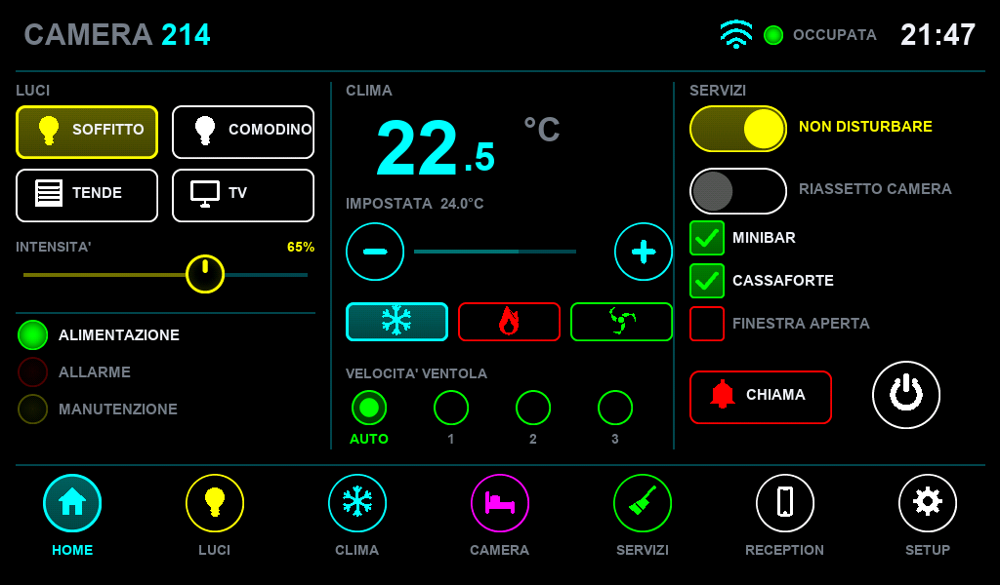
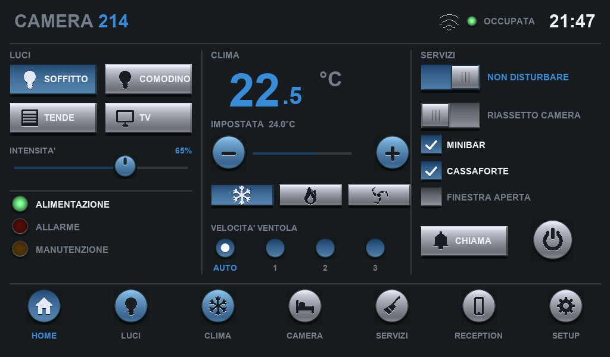
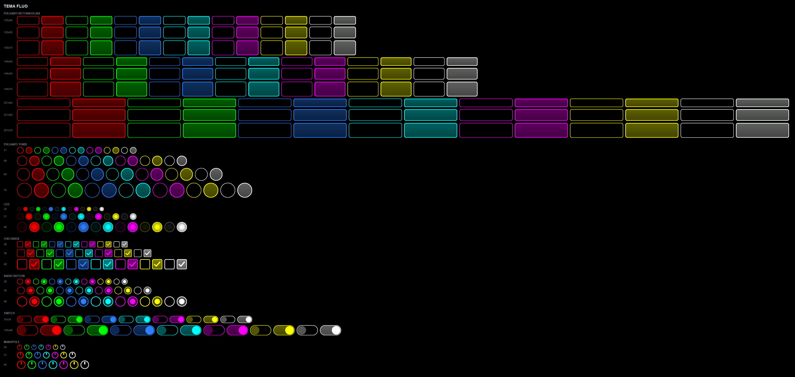
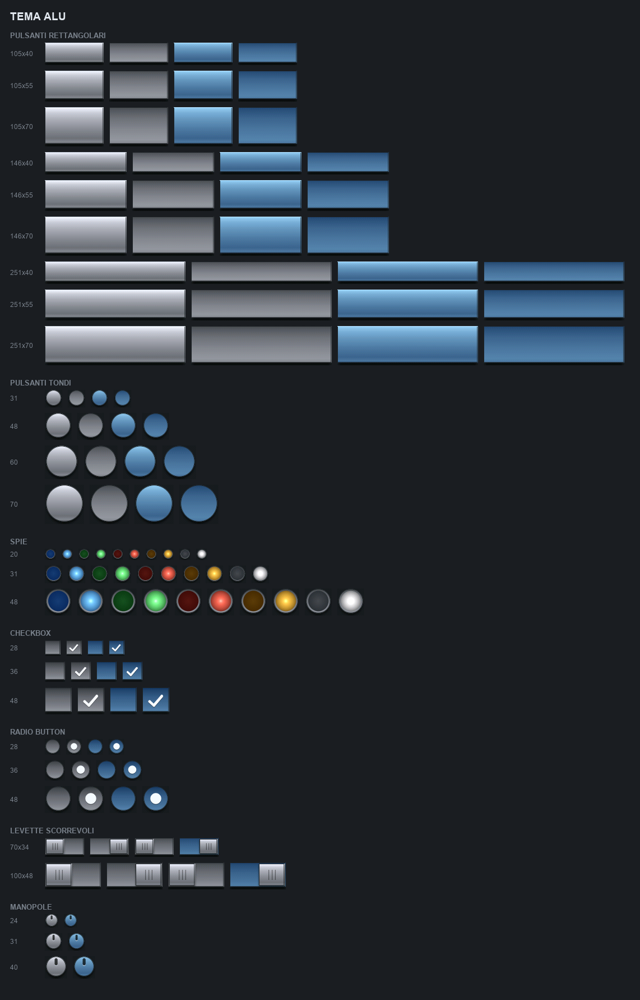

# ThemeDemo — three graphic themes in one binary

One `All_76_Pic_65K.bin` in the display flash holds **three complete themes**.
The sketch changes look at run time by pointing at another block of indices:
nothing is reprogrammed.

| theme | look | images | indices |
|---|---|---|---|
| **glass** | the one shipped with the board | 31 | 0 … 30 |
| **fluo** | pure-colour neon on black | 357 | 31 … 387 |
| **alu** | brushed aluminium, relief and shadow | 120 | 388 … 507 |

Total **508 images, 4.39 MB**.

The **69 symbols** are not in there: they are two fonts in `font.bin`,
`symbols_32pt` and `symbols_48pt`, shared by all themes. Printed like text they
are transparent and take any colour at run time (see
[Symbols](#symbols-a-font-not-images)).




---

## Getting started

1. Copy [`src/Horizzontal/font.bin`](../../src/Horizzontal/font.bin) and
   [`src/All_76_Pic_65K.bin`](../../src/All_76_Pic_65K.bin) to the root of a
   microSD card and insert it in the board.
2. Open this sketch and upload it.

On the first boot the library writes both files into the display flash by
itself: `RA8876::init()` ends with `copySDtoFlash()`, which rewrites `font.bin`
and `All_76_Pic_65K.bin` whenever it finds them on the card. With no card, or
no such files, it does nothing, so it is safe to leave in on every boot.
Together they are ~8 MB, so that first boot is slow; take the card out and the
later ones are not.

The new `font.bin` only **adds** the two symbol fonts at the end: every text
font keeps its address, and the images still start at `0x3B0000`.

Then press `GLASS` / `FLUO` / `ALU` at the bottom of the screen.

### Requirements

- Board: **Arduino Zero (Native USB Port)**, Arduino SAMD core.
- Libraries: this one, plus **FT5206** (sumotoy) for the 7" panel.
- `src/` must hold the fonts for this orientation (`font.h`, `fontExt.h` and
  `fontSymbols.h` from `src/Horizzontal/` for 1024x600), and the matching
  `font.bin` (`ENDFLASH 3837052`, with the symbol fonts) must be in the display
  flash.
- In `GUIslice/src/GUIslice_config.h` this line must be enabled:
  `#include "../configs/ard-shld-gevino_tft.h"`.

---

## What the demo shows

Three real **GUIslice pages**, one per theme, each with its own background.
Everything animates on its own:

- a chain of six running lights,
- the dimmer (`XSlider`) sweeping back and forth — touch it and the automation
  is suspended for six seconds,
- a level bar (`XProgress`) going up and down,
- the temperature swinging between 18.5 and 24.5 °C,
- a blinking alarm lamp,
- the toggle (`XTogglebtn`) and the checkbox (`XCheckbox`) flipping every 4 s,
- three symbols cycling, in each theme's colours,
- a symbol printed right on top of the round button, on every theme,
- a clock.

These are genuine GUIslice elements; a draw callback paints them with the
theme's images instead of GUIslice's own graphics.

**Check and toggle are missing from the GLASS page** on purpose: that artwork
does not exist yet, so the widgets are simply not created. When the images are
there, filling in the matching entries of the `THEMES` table brings them back.

The three buttons at the bottom switch page, i.e. theme, and are drawn with the
artwork of the **theme on screen**, so the bar stays coherent with the page.

Every string is drawn with the **GEVA flash fonts** (`setFont` + `print`),
never with the controller's internal ROM font.

### Touch

Both panels work and are detected at start-up by the library
(`gevino_tft_touch.*`): FT5206 on the 7" at I2C `0x38`, GT9271 on the 10" at
`0x5D`. GUIslice only knows the FT5206, so on a 10" board the bridge
`gevino_tft_touch_gslc.h` reads the GT9271 and injects the points with
`gslc_TrackTouch()`.

> The demo holds 3 pages × 12 elements in RAM. It fits the SAMD21 (32 KB) with
> room to spare, but if you add elements and the board starts misbehaving, the
> first thing to cut is the number of pages.

---

## Using the images in your own sketch

The enum names are descriptive, so you can type them from memory:

```cpp
#include "All_76_Pic_65K.h"     // from src/: the three themes together

tft.pic(fluo_rect_146_55_magenta_released, 100, 100);
tft.pic(alu_round_70_blue_pressed,         300, 100);
tft.pic(glass_round_31_led_green,          500, 100);
```

```
<theme>_rect_<width>_<height>_<colour>_<released|pressed>
<theme>_round_<diameter>_<colour>_<released|pressed>
<theme>_led_<diameter>_<colour>_<off|on>
<theme>_check_<side>_<colour>_<off|on>
<theme>_radio_<diameter>_<colour>_<off|on>
<theme>_switch_<width>_<height>_<colour>_<off|on>
<theme>_knob_<diameter>_<colour>
```

Colours: **fluo** `red green blue cyan magenta yellow white` · **alu**
`alu blue` (lamps `blue green red amber white`) ·
**glass** buttons, rounds and lamps `yellow green red orange off` only.

`rect` (105/146/251 × 40/55/70) and `round` (Ø 31/48/60/70) are the **same
sizes in all three themes**, so you can swap theme without redoing the layout.

---

## The background is part of the theme

Each theme assumes a screen background colour. This is not cosmetic: the ALU
shadows are pixels darker than the background, and on pure black they vanish.

| theme | background | RGB565 |
|---|---|---|
| glass | `#2390EC` GEVA blue | `0x249D` |
| fluo | `#000000` pure black | `0x0000` |
| alu | `#1A1D21` dark grey | `0x18E4` |

The demo sets it on every theme change with `gslc_SetBkgndColor()`.

---

## Transparency on this board

Images from flash are blitted with `pic_b()` → `DMA_24bit()`. That is a **raw
copy: it writes every pixel and has no chroma key.** So:

- **Button labels** are printed on top with the GEVA fonts. Those *are*
  transparent: the BTE expands the 1-bit glyphs with colour expansion and
  chroma keying (opcode 0xE/0xF), and `setTextColor()` picks the colour at run
  time.
- **Symbols** are a font too, so they get the same transparency: they can sit
  on the background or on top of any button of any theme.
- `GSLC_BMP_TRANS_EN` in GUIslice (magenta `0xFF00FF` in the GEVINO config)
  only applies to images GUIslice draws from RAM/PROGMEM: **it does not touch
  the DMA path**.

## Symbols: a font, not images

GEVA font glyphs are **1 bit**, and the BTE lays them down with colour
expansion + chroma keying — transparent background, colour chosen at run time.
So the 69 symbols live in `font.bin` as two fonts, `symbols_32pt` and
`symbols_48pt`, and `fontSymbols.h` names them:

```cpp
#include "fontSymbols.h"

tft.setFont(&symbols_48pt);
tft.setTextColor(CYAN);          // one argument = transparent background
tft.setCursor(x, y);
tft.print(SYM_POWER);
```

- **real transparency** over any button of any theme;
- **one font for every theme and every colour**;
- **29 KB** instead of the 4.38 MB the symbol images took: the image binary
  went from 8.77 to 4.39 MB.

The glyph is square and as large as the font, so at the same `x, y` it lands
where the old `<theme>_sym_<name>_<32|48>_<colour>` image did. The macros are
strings and can be chained: `tft.print(SYM_PLAY SYM_PAUSE)`.

The ALU engraved look is two prints: the edge colour 1 px lower, then the
stroke on top (`Symbol()` in the sketch does exactly that).

---

## Full catalogue




Each theme holds rectangular buttons (9 sizes) and round ones (4), lamps (3),
checkboxes (3), radios (3), sliding switches (2) and knobs (3). The **69
symbols**, in two sizes, are the `symbols_32pt` / `symbols_48pt` fonts; the
macro is `SYM_` plus the name in capitals (`SYM_ARROW_UP`, `SYM_BULB`, ...).

```
arrow_up arrow_down arrow_left arrow_right
chevron_up chevron_down chevron_left chevron_right
play pause stop record next_track prev_track forward rewind volume mute
plus minus check cross power home menu more gear refresh search edit
trash save download upload exit
lock unlock key user
info warning question star heart bell dnd
bulb fan snowflake flame thermometer sun moon drop leaf
door bed blinds shower clean tv phone clock calendar
wifi bluetooth battery plug eco
```

(glass has only buttons, rounds and lamps: it is the board's original theme,
included unchanged for compatibility)

---

## A theme of your own

These themes are produced by a Python generator that writes the `.bin` and the
`.h` by itself — RAiO's `Image_Tool.exe` is not needed. Colours, sizes, symbols
and rendering are changed by asking in plain language.

The generator is not part of this repository. **Ask
[GEVA Elettronica](https://www.gevaelettronica.it) if you want it.**

---

## Binary format

RGB565 **little endian** images, concatenated, no header and no padding.
`start_addr` is the sum of the preceding sizes, `img_size` is always
`width × height × 2`.

The byte order is not documented by RAiO: it was determined by decoding the
glass theme binary under both hypotheses and comparing against the source BMPs
— little endian is off by 2.30/255 (just the 16-bit quantisation), big endian
by 90.75.
